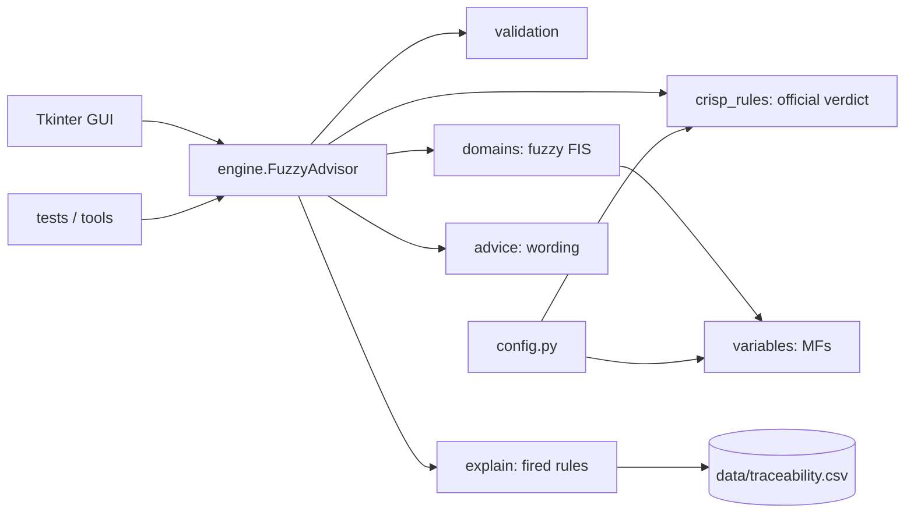

# Design Document: Bahria Handbook Fuzzy Advisor

**Status:** Draft v0.1. Parameters marked *(draft)* are finalised after rule extraction (Milestones M1 and M2).
**Course:** Knowledge Representation & Reasoning, Assignment #2, Fall 2026
**Source document:** Bahria University Student Handbook, Spring 2026
**Page convention:** all page numbers are **printed** page numbers. PDF page = printed page + 10.

---

## 1. Purpose and scope

Build a Mamdani fuzzy inference system (FIS) that answers common student questions using rules
extracted from the handbook, with a desktop GUI, full rule traceability and a tested evaluation.

**In scope**
- Domain A: probation and drop
- Domain B: scholarship retention
- Undergraduate, non-engineering programmes only
- Tkinter desktop GUI

**Out of scope** (deliberately, to protect time)
- Honours, medals and the Rector's list (§5.6-5.9). Possible extension only if time remains
- Rank-based scholarship amounts (70/40/30%), financial-need assessment, Qarz-e-Hasna (discontinued)
- Engineering programmes, MS/MPhil/PhD thresholds, final-semester extra-course exceptions
- Web deployment

## 2. Core design principle: hybrid verdict plus fuzzy risk

The handbook is a set of crisp rules: CGPA 1.99 is probation, 2.00 is not. A fuzzy set cannot
represent a cliff, so a purely fuzzy system can never give the official verdict at a boundary.

Therefore every answer has two parts:

| Part                      | Source                                                             | Purpose                                                         |
|---                        |---                                                                 |---                                                              |
| **Official verdict**      | `crisp_rules.py`, a direct transcription of the handbook threshold | Correct and authoritative                                       |
| **Fuzzy risk and advice** | Mamdani FIS                                                        | Graded "how close to trouble" signal the handbook does not give |

The GUI always shows the official verdict first. The fuzzy layer never overrides it.

**Honest limitation:** a plain `if cgpa < 2.0` reproduces the official
verdict with 100% accuracy, so the fuzzy layer adds nothing to the verdict itself. Its value is the
graded risk output, which answers "am I in danger?" rather than "which side of the line am I on?".

**Why fuzzy is still defensible**
1. The assignment requires boundary values to be handled "carefully" with fuzziness explained near them.
2. Students ask about distance to a threshold, which is a question of degree.
3. The handbook uses undefined vague terms: "regular course load" (§4.4.3.5, §4.12(b)).
4. Entered CGPAs are often rounded or predicted, and the grade table jumps a full grade point between adjacent percentages (§5.3.1, p.70).
5. Transition widths are tied to the handbook's own grade step (see §5).

## 3. Domains and handbook sources

### Domain A: Probation and drop

| Clause | Printed page | Content used                                                            |
|---     |---           |---                                                                      |
| §5.5.1 | 71           | Probation if CGPA below minimum; minimum 2.0 for BBA/BEE/BS             |
| §5.5.3 | 71           | Drop after failing to reach minimum following two consecutive probations|
| §5.5.4 | 71           | Reaching the minimum ends probation and resets the count                |
| §5.5.5 | 71-72        | A student on a second consecutive probation needs approval to register  |

### Domain B: Scholarship retention

| Clause                  | Printed page | Threshold                                                        |
|---                      |---           |---                                                               | 
| §4.4.3.3                | 52           | Merit (batch topper): GPA ≥ 3.75 (non-engineering)               |
| §4.3.2.2, §4.3.3.1.2(b) | 50-51        | Advance merit continuation: GPA/CGPA ≥ 3.50                      |
| §4.5.2, §4.5.3(d)       | 53           | Financial assistance: GPA/CGPA ≥ 2.50, otherwise withheld        |
| §4.11                   | 55           | Holders below the required GPA are suspended until grades recover|
| §4.4.3.5, §4.12(b)      | 52, 55       | "Regular course load" required (undefined numerically)           |
| §1.10.1, §1.10.2.1      | 8            | Minimum 9 and maximum 18 credit hours (used to anchor "regular") |

## 4. Architecture

Rules of the architecture:
- The GUI contains **no** fuzzy or handbook logic. It calls `FuzzyAdvisor.evaluate()` only.
- `crisp_rules.py` imports nothing from scikit-fuzzy. It is the ground truth for tests.
- All handbook numbers live in `config.py`, each with its clause.
- `explain.py` is the only module allowed to read scikit-fuzzy's firing strengths.
- `data/traceability.csv` is the single source of truth for rule text, source and highlight colour. The report table, GUI rule references and handbook highlighting are all generated from it.

## 5. Fuzzy model

### 5.1 Common settings

| Setting | Choice | Reason |
|---|---|---|
| Inference | Mamdani | scikit-fuzzy supports Mamdani only; standard and easy to explain |
| AND / OR | min / max | scikit-fuzzy defaults |
| Implication | Clipping (min) | scikit-fuzzy default |
| Aggregation | max | scikit-fuzzy default |
| Defuzzification | Centroid | Smooth output, standard choice |
| Resolution | CGPA 0.01, credit hours 0.5, risk 1 | Fine enough to resolve 1.99 vs 2.00 |

### 5.2 Variables

| Variable | Role | Domain | Universe | Terms |
|---|---|---|---|---|
| `cgpa` | Input (A, B) | A, B | 0.00 - 4.00 | below_min, borderline, safe |
| `probation_count` | Input | A | {0, 1, 2} | none, first, second |
| `credit_load` | Input | B | 0 - 18 | under_load, regular |
| `risk` | Output | A, B | 0 - 100 | low, moderate, high, critical |

`scholarship_type` is **not** a fuzzy variable. It selects which crisp threshold anchors the CGPA terms.

### 5.3 CGPA terms, anchored at the handbook threshold T *(draft)*

Let `w = 0.33` (one grade step, §5.3.1) and `w_up = min(w, 4.00 − T)`.

| Term | Shape | Parameters |
|---|---|---|
| below_min | trapezoid | [0, 0, T − w, T] |
| borderline | triangle | [T − w, T, T + w_up] |
| safe | trapezoid | [T, T + w_up, 4.00, 4.00] |

The truncation `w_up` is required: without it, a perfect 4.00 CGPA would only be 76% "safe" at
T = 3.75. Memberships (checked in a prototype) for every T in {2.00, 2.50, 3.50, 3.75}:

| CGPA | below_min | borderline | safe |
|---|---|---|---|
| T − w or lower | 1.00 | 0.00 | 0.00 |
| T − 0.01 | 0.03 | 0.97 | 0.00 |
| T | 0.00 | 1.00 | 0.00 |
| 4.00 | 0.00 | 0.00 | 1.00 |

Choice of three terms: the handbook defines one decisive threshold per rule, so the minimum
vocabulary is "below it", "at it", "above it". More terms would have no handbook text to justify them.

### 5.4 Other terms *(draft)*

| Variable | Term | Shape | Parameters |
|---|---|---|---|
| credit_load | under_load | trapezoid | [0, 0, 6, 9] |
| credit_load | regular | trapezoid | [6, 9, 18, 18] |
| probation_count | none / first / second | triangle | [0,0,1] / [0,1,2] / [1,2,2] |
| risk | low | triangle | [0, 0, 33] |
| risk | moderate | triangle | [0, 33, 67] |
| risk | high | triangle | [33, 67, 100] |
| risk | critical | triangle | [67, 100, 100] |

Credit-load transition width of 3 equals one three-credit course. This is **Assumption A1**.
Four risk levels map to four distinct pieces of advice: nothing, monitor, act now, imminent drop.

## 6. Rule base outline *(draft: replaced by `data/traceability.csv`)*

Rule type **direct** means the handbook text states the condition. **derived** means the rule is the
fuzzy extension of a direct rule into the transition zone. Derived rules must be labelled as such in
the traceability table.

### Domain A

| ID | IF | THEN risk | Type | Clause |
|---|---|---|---|---|
| A1 | cgpa is safe | low | direct | §5.5.1, §5.5.4 |
| A2 | cgpa is borderline AND count is none | moderate | derived | §5.5.1 |
| A3 | cgpa is borderline AND count is first | high | derived | §5.5.1, §5.5.3 |
| A4 | cgpa is borderline AND count is second | critical | derived | §5.5.3 |
| A5 | cgpa is below_min AND count is none | high | direct | §5.5.1 |
| A6 | cgpa is below_min AND (count is first OR second) | critical | direct | §5.5.3, §5.5.5 |

### Domain B (with `cgpa` anchored at the chosen scholarship threshold)

| ID | IF | THEN risk | Type | Clause |
|---|---|---|---|---|
| B1 | cgpa is safe AND load is regular | low | direct | §4.4.3.3, §4.11 |
| B2 | cgpa is borderline AND load is regular | moderate | derived | §4.11 |
| B3 | cgpa is below_min | high | direct | §4.11, §4.5.3(d) |
| B4 | cgpa is safe AND load is under_load | moderate | direct | §4.4.3.5, §4.12(b) |
| B5 | cgpa is borderline AND load is under_load | high | derived | §4.4.3.5, §4.11 |

## 7. Boundary handling

Official verdict rule: **a value exactly equal to the threshold meets the requirement** (`>=`).
Example for T = 2.00, probation count 0:

| CGPA | Official verdict | Fuzzy risk |
|---|---|---|
| 1.67 or lower | Probation (§5.5.1) | high |
| 1.99 | Probation (§5.5.1) | moderate (97% borderline) |
| 2.00 | Good standing | moderate (100% borderline) |
| 2.01 | Good standing | moderate (97% borderline) |
| 2.33 or higher | Good standing | low |

**Known tension (documented behaviour, not a bug):** at 1.99 the student is officially on probation
but the fuzzy risk is only "moderate", because 1.99 and 2.00 are nearly identical to a fuzzy set. The
advice text resolves this by always leading with the official verdict:
*"Official status: ON PROBATION. Fuzzy risk: moderate, you are just under the line."*

**Invariants tested automatically**
- **I1:** the official verdict always equals `crisp_rules` output
- **I2:** the risk **label** never becomes less severe as CGPA falls (other inputs fixed). Checked at band level, not on the raw score
- **I3:** if the verdict is worse than good standing / eligible, the risk label is at least moderate

**Finding from the prototype (use in the failure analysis):** the raw score is not strictly monotonic
for probation count 2. Between CGPA 1.90 and 2.00 it rises from about 87.4 to 89.0 while the label stays
"critical". Cause: rules A4 and A6 both output "critical", and as `borderline` grows the clipped
"critical" shape gets taller, which pulls the centroid toward its peak. This is a known property of
centroid defuzzification with overlapping same-term rules, so I2 is tested on labels. Counts 0 and 1
were strictly non-increasing in the same test.

The `risk_label` is the output term with the highest membership at the crisp score; ties go to the more severe term.

## 8. Input validation policy

Invalid input raises `InputError` with a clear message and is shown in the GUI. It is **never
clamped or guessed**.

| Input | Valid | Rejected examples |
|---|---|---|
| CGPA | number, 0.00 to 4.00 | -0.1, 4.01, "abc", empty, nan, inf, "2,5" |
| Probation count | 0, 1 or 2 | 3, -1, 1.5 |
| Credit hours | number, 0 to 18 | -3, 19 (§1.10.2.1 maximum) |
| Scholarship type | one of the three configured keys | anything else |

## 9. Explainability: rules fired

- Each scikit-fuzzy `Rule` is created with `label=<rule_id>`.
- After `compute()`, `explain.fired_rules()` reads `rule.aggregate_firing[sim]`, keeps strengths above 0 and sorts descending.
- `rule.aggregate_firing` is not documented public API. It works on scikit-fuzzy 0.5.0 (verified), so the version is pinned and the access is isolated in one function.
- A second, independent implementation (`independent_strengths`, min/max over `interp_membership`) is used as a test oracle and as a fallback.

## 10. GUI design (Tkinter, desktop only)

- `ttk.Notebook` with tabs: **Probation & Drop**, **Scholarship**, **Membership functions**.
- Left: input panel (labelled fields, comboboxes, Evaluate and Clear buttons).
- Right top: result card with official verdict, risk score (0-100), linguistic label, advice text, error banner.
- Right middle: fired-rules table (rule ID, IF-THEN, strength, handbook reference).
- Bottom: embedded Matplotlib plot (membership functions and the clipped/aggregated output with centroid line). Output surface is a secondary plot.
- Rationale: the layout follows the assignment checklist (crisp output, linguistic interpretation, rules fired) one-to-one so a grader can tick each item at a glance.

## 11. Testing and evaluation

`data/test_queries.csv`, minimum 32 rows:

| Category | Count | Examples |
|---|---|---|
| Normal | 12 | typical CGPAs across both domains, all probation counts, all scholarship types |
| Boundary | 12 | 1.99/2.00/2.01, 2.49/2.50/2.51, 3.49/3.50/3.51, 3.74/3.75/3.76, credit hours 8/9/18/19, CGPA 0.00 and 4.00 |
| Invalid | 8 | out-of-range, non-numeric, empty, unknown type |

- **Expected answer** = the handbook verdict (exact) and a risk band (design-derived, flagged as such).
- **Pass** = verdict matches AND risk band matches. Invalid rows pass only if the engine raises the expected error.
- Property tests (I1-I3) run in `pytest`; `tools/evaluate.py` produces the pass/fail table, total count and accuracy for the report.
- A 100% score is not the goal. Cases are chosen to expose weaknesses, and every failure gets a cause and an improvement in the report.

## 12. Assumptions and open decisions

| ID | Assumption | Impact |
|---|---|---|
| A1 | "Regular course load" = 9 to 18 credit hours with 3-hour transitions; the handbook does not define it | Domain B load rules are design-derived |
| A2 | Non-engineering undergraduate programmes only (3.75 merit threshold; engineering uses 3.60) | Narrows scope |
| A3 | Fuzzy transition half-width = 0.33, one grade step | Width has no handbook ground truth; justified, not proven |
| A4 | CGPA input stands for GPA in a student's first semester (§5.5.1 wording) | Documented, not modelled separately |

**Handbook inconsistencies found (use in the report):**
- §5.5.4 refers to "clause 7.10.1", which does not exist (probably §5.5.1)
- The grade table in §1.18.1 uses ">" while §5.3.1 uses "≥" for the same bands
- Baseline honours CGPA (3.60, §5.6.3) differs from the merit scholarship threshold (3.75, §4.4.3.3)

## 13. Traceability and highlighting workflow

1. Copy each source passage's anchor text from the handbook text layer (the PDF has OCR spacing artefacts such as "f ollowing", so copy from extracted text, not by eye).
2. Fill `data/traceability.csv`: `rule_id, domain, rule_type, section, printed_page, pdf_page, original_text, fuzzy_rule, color_hex, highlight_anchor`.
3. One colour per rule from `config.RULE_COLORS`.
4. `tools/highlight_handbook.py` writes `report/handbook_highlighted.pdf` using the same colours.
5. The same colour is applied to the rule row in the report.

## 14. Milestones and cut line

| # | Milestone | Priority |
|---|---|---|
| M0 | Repo scaffold and this document | done |
| M1 | Rule extraction: `traceability.csv` complete, handbook highlighted | P0 |
| M2 | Engine: variables, crisp rules, domains, explain, with unit tests | P0 |
| M3 | Tkinter GUI | P0 |
| M4 | Test set, evaluation run, 10+ worked examples | P0 |
| M5 | Report and single-PDF assembly | P0 |
| M6 | Polish: README screenshots, GUI recording | P1 |

**Rough effort (estimated):** about 21-25 hours in total.

**If time runs short, cut in this order:**
1. Output-surface plot
2. README polish
3. `credit_load` input (Domain B reduces to CGPA only; drop rules B4 and B5)

**Never cut:** the traceability table, the fired-rules display, the 30+ query evaluation with failure analysis.
