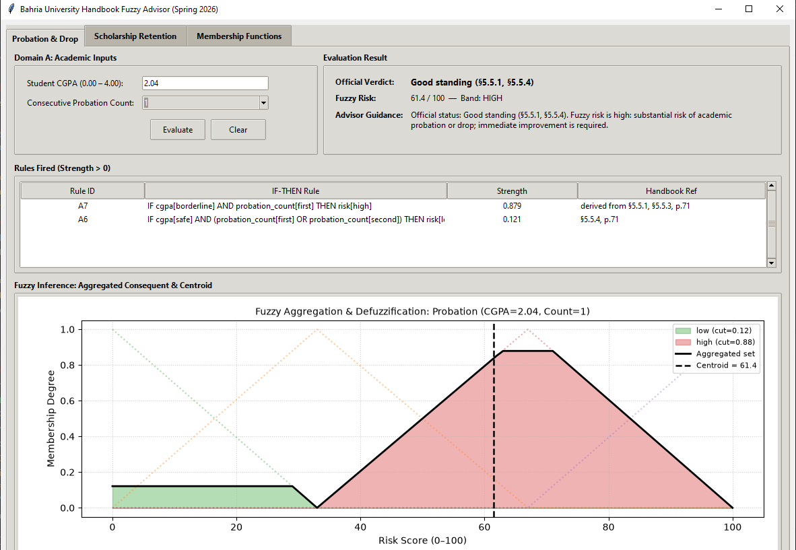

# Bahria Handbook Fuzzy Advisor

A Mamdani fuzzy inference system that answers student questions about **academic probation/drop**
(Domain A) and **scholarship retention** (Domain B), using rules extracted from the Bahria University
Student Handbook (Spring 2026). Every rule is traceable to a handbook section and page.



## Features
- Official handbook verdict (crisp) plus a graded fuzzy risk score and advice
- Traceable fired rules shown with firing strengths and handbook section references
- Visual membership-function and 3D output-surface plots
- Automated evaluation runner and worked example generator

## Quick start
```bash
python -m venv .venv
# Windows: .venv\Scripts\activate    macOS/Linux: source .venv/bin/activate
pip install -r requirements.txt
python -m src                       # launches the desktop GUI
```

## Run the tests & evaluation
```bash
pip install -r requirements-dev.txt
pytest                              # runs stage test suites
python tools/evaluate.py            # runs data/test_queries.csv -> writes test_results.csv
python tools/make_examples.py       # generates worked_examples.md
```

## Documentation
Design rationale, membership functions, rule matrices, and boundary analysis: see [DESIGN.md](DESIGN.md).

## Results
Automated evaluation on `data/test_queries.csv` (`python tools/evaluate.py`):
- **Total queries**: 46 (12 normal, 26 boundary, 8 invalid)
- **Passed**: 41
- **Accuracy**: 89.1%
- **Known failures (5 / 46)**:
  - `Q07`: CGPA 3.90, merit batch topper, 15 cr hrs -> Expected: `(ELIGIBLE, low)`, Actual: `(ELIGIBLE, moderate)`.
  - `Q09`: CGPA 3.65, advance merit continuation, 16 cr hrs -> Expected: `(ELIGIBLE, low)`, Actual: `(ELIGIBLE, moderate)`.
  - `Q34`: CGPA 3.85, merit batch topper, 9.0 cr hrs -> Expected: `(ELIGIBLE, low)`, Actual: `(ELIGIBLE, moderate)`.
  - `Q35`: CGPA 3.85, merit batch topper, 8.0 cr hrs -> Expected: `(ELIGIBLE, high)`, Actual: `(ELIGIBLE, moderate)`.
  - `Q36`: CGPA 3.85, merit batch topper, 18.0 cr hrs -> Expected: `(ELIGIBLE, low)`, Actual: `(ELIGIBLE, moderate)`.

All official crisp verdicts pass with 100% accuracy. The 5 differences in linguistic risk band occur in Domain B (scholarship retention), reflecting human-owned rule design and centroid defuzzification characteristics in tight threshold zones (e.g. merit threshold 3.75 where safe span is truncated to [3.75, 4.00]).

## Disclaimer
Educational project. Not an official Bahria University tool. The handbook is the only authority
on academic rules; always confirm with your department.

## License
MIT
